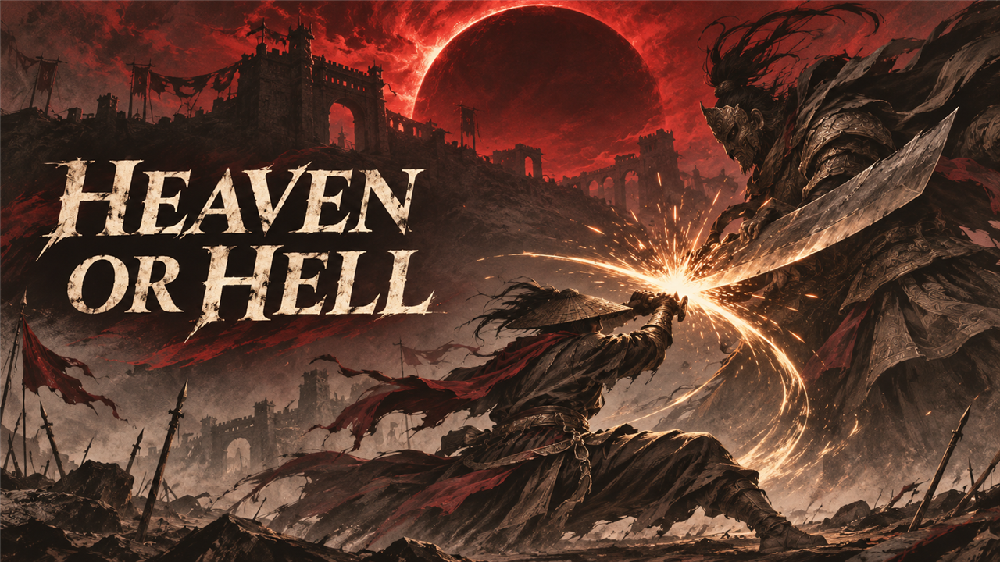

# Heaven or Hell

Your hits kill only right after a timed parry or dodge; every other hit deals 1 damage. Enemies kill you in one hit.

## What it does

A "Heaven or Hell" mode with a timing twist, inspired by Devil May Cry:

- Parry an attack at the right moment, or dodge through it, and for 1.2 seconds every hit of yours kills, bosses
  included, and every enemy you hit in that time.
- Every other hit of yours deals almost nothing (about 1 damage; light hits less, heavy hits a little more). So the
  fight is about timing: parry or dodge, then strike.
- The red-light perfect dodge and the blue-light parry open the window too; after the red-light dodge it stays open
  until the game's counter attack is done. A block (holding the parry button) does not.
- Enemy hits kill you in one hit (a setting turns this off).
- Sha-Chi (posture damage) stays as in the game.

It is a UE4SS script; it changes no game file. The window and the damage are settings.

## Screenshots

## How to install

1. Install UE4SS for Phantom Blade Zero, for example [UE4SS](https://github.com/KintaroModding/ue4ss) (its zip
   `phantombladezero_ue4ss_<version>.zip`: the official UE4SS build with a config that makes it run in this game).
2. Download the zip of the latest release on GitHub (`phantombladezero_heavenorhell_<version>.zip`).
3. Unpack it into the game folder `platform\steam\`, next to the game's exe. It adds the folder
   `ue4ss\Mods\phantombladezero_heavenorhell\` (with the file `enabled.txt`, UE4SS starts it by itself).
4. Start the game.

To check that it runs: `platform\steam\ue4ss\UE4SS.log` has the line `[Heaven or Hell] <version> loaded.`

To update the mod, replace the folder with the one of the new release; to keep your settings, put your old
`Scripts\config.lua` back (a setting that it does not have keeps its default). To remove it, delete the folder
`ue4ss\Mods\phantombladezero_heavenorhell\`.

## How to use

Nothing to do: parry at the right moment or dodge through an attack, then strike right away.

## Settings

The settings are in `platform\steam\ue4ss\Mods\phantombladezero_heavenorhell\Scripts\config.lua`. Open it with a
text editor, change a value and save: the mod reads the file every 5 seconds, so the game uses it without a restart.
Turning a part off (`Enable`, `EnemyOneShot`) gives your attack and damage taken back to the game's at once.
`UE4SS.log` shows the settings in use in the line `[Heaven or Hell] Settings: ...`, and names each value it could not
use.

| Setting | Default | What it does |
|---|---|---|
| `Enable` | `true` | `false` turns the mod off without removing it |
| `WindowMs` | `1200` | After a timed parry or a dodge, your hits kill for this many milliseconds (from 50 to 5000); what counts is when your swing starts |
| `NormalDamage` | `1` | Every other hit of yours deals about this much damage (light hits less, heavy hits more) |
| `EnemyOneShot` | `true` | `true`: enemy hits kill you in one hit |
| `LogHits` | `false` | `true`: `UE4SS.log` names each trigger, attribute change and health change (for tests and bug reports) |

## Compatibility

- Game version: Steam build 26367565 (`CL-302256_JKS-17280`).
- Tested with UE4SS `v4.0.0`.
- Works with [Witch Time](https://github.com/KintaroModding/phantombladezero_witchtime) (the same triggers; the window
  is real time, and Witch Time's slow world makes it easier to land a hit in it).
- [Easier Parry and Dodge](https://github.com/KintaroModding/phantombladezero_easierparryanddodge) widens the timed
  parry and dodge windows, so the kill window opens more often.
- A mod that lowers the damage you take has no effect while `EnemyOneShot` is on.
- The mod changes your character's attack and damage-taken values while it runs and never touches their base
  values; it gives the game's values back when you turn a part off, and the game puts its own values back after you
  remove the mod.

## Known issues

None yet.

## How to build

There is nothing to build: `src\phantombladezero_heavenorhell\Scripts\main.lua` is the mod. `tests\test_main.py`
runs the script outside the game with Lua 5.4 ([lupa](https://pypi.org/project/lupa/)) and mocks of UE4SS:
`python tests\test_main.py`. `README.md` has the details.

## Credits

Made by Kintaro. MIT license: you may use, change and share this mod. UE4SS is made by the
[UE4SS-RE team](https://github.com/UE4SS-RE/RE-UE4SS). Phantom Blade Zero belongs to its makers. The idea of a mode
where every hit kills comes from the "Heaven or Hell" mode of Capcom's Devil May Cry games.
